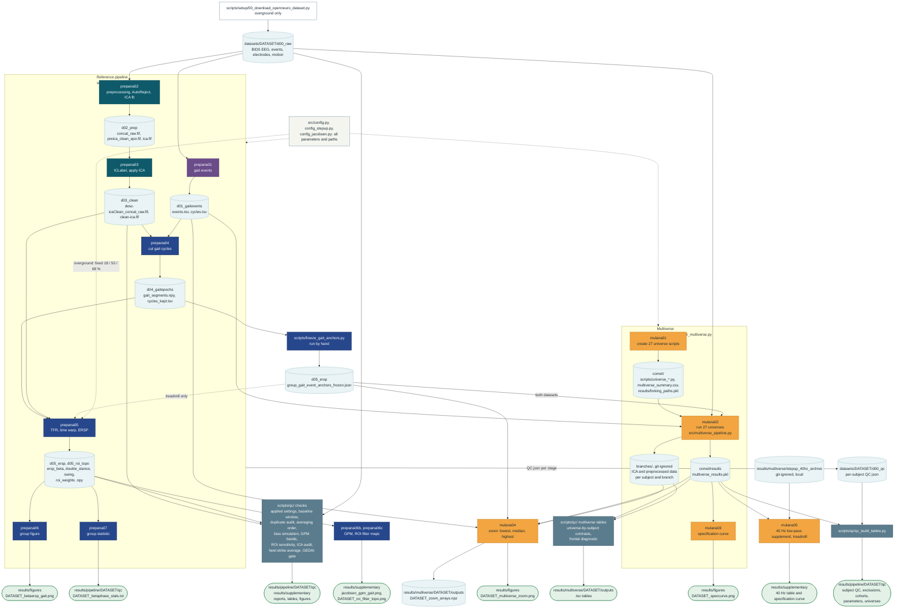

# Multiverse analysis of beta activity during gait

Does beta power (13-30 Hz) differ between double stance and
swing during walking, and does the answer survive defensible changes to EEG
preprocessing? This repository computes the per-subject double-stance - swing
beta contrast in two independent datasets (treadmill and overground walking)
with a fixed reference pipeline per dataset, and repeats it over the same
27-universe preprocessing multiverse (high-pass x ASR x IC rule) in both
(Steegen et al. 2016; Clayson et al. 2021).

Main results: treadmill t(16) = 5.13 (n = 17); overground primary cohort
t(13) = 3.50 (n = 14 independent recordings); 27 / 27 universes p < 0.05 in
each dataset.

## Datasets

| Key | Label | Source | Access | Format, events |
|---|---|---|---|---|
| `stepup` | treadmill | stepUpAms, VU Amsterdam: treadmill walking, separate standing (STAND) and constant-speed walking (CS) recordings | not distributed with this repository (see Open items) | BIDS BrainVision; gait events detected from optical motion capture |
| `jacobsen` | overground | Jacobsen et al. 2020, OpenNeuro [ds003039](https://openneuro.org/datasets/ds003039) ("A walk in the park?"): outdoor walking, steady even-terrain segment | public; `python scripts/setup/00_download_openneuro_dataset.py` | BIDS EEGLAB; gait events from the dataset's events.tsv |

Place the raw data in `datasets/<key>/d00_raw/` (BIDS root). Every later stage
writes to `datasets/<key>/d01_...` to `d05_...` and `d00_qc/`; `datasets/` is
not tracked. Overground caveats: three duplicate-recording groups at the
source (handled by the primary cohort) and sub-019 truncated at the source;
see `docs/cohorts.md`.

## Install

Python 3.13 and [uv](https://github.com/astral-sh/uv):

```bash
uv venv --python 3.13
.venv\Scripts\activate          # Windows; macOS/Linux: source .venv/bin/activate
uv pip install -e .             # runtime dependencies, exact versions (pyproject.toml)
uv pip install -e ".[dev]"      # + pytest, ruff
uv pip install -e ".[gedai]"    # + gedai, only for scripts/qc/qc_gedai_gate.py
```

`uv.lock` records the full resolved environment. `docs/environment_used.txt`
is the `uv pip freeze` of the environment that produced every stored result:
the direct dependencies equal the pins in `pyproject.toml`; some transitive
packages are older than in `uv.lock`. Stage 5 rerun for S1 and sub-001 in an
environment built from `uv.lock` gives bit-identical ERSP arrays (2026-10-16).

## How to run

The active dataset is set with `BETAGAIT_DATASET=stepup` (default) or
`BETAGAIT_DATASET=jacobsen`. Other environment variables: `BETAGAIT_USE_ASR`
overrides the reference ASR setting (default per dataset: treadmill off,
overground SD 20); `BETAGAIT_DATASETS_DIR` points all data inputs and outputs
to another folder (used to rerun a stage for one subject without touching
`datasets/`).

```bash
# 1. Reference pipeline, per dataset (stages 1-7; prepana02-05 accept one subject ID)
BETAGAIT_DATASET=stepup   python scripts/main_script_eegpipeline.py
BETAGAIT_DATASET=jacobsen python scripts/main_script_eegpipeline.py

# 2. Supplementary reference figures
python scripts/prepana06b_plot_gpm_supplement.py                        # overground only
BETAGAIT_DATASET=<key> python scripts/prepana06c_plot_roi_filter_supplement.py

# 3. Multiverse, per dataset
BETAGAIT_DATASET=<key> python scripts/main_script_multiverse.py         # mulana01-03 (--force restarts)
BETAGAIT_DATASET=<key> python scripts/mulana04_zoom_universes.py
python scripts/mulana05_lowpass40_supplement.py                         # treadmill only

# 4. QC tables and checks (one script per question; see the QC READMEs)
BETAGAIT_DATASET=<key> python scripts/qc/qc_build_tables.py
BETAGAIT_DATASET=<key> python scripts/qc/qc_applied_settings.py
BETAGAIT_DATASET=<key> python scripts/qc/qc_baseline_window.py
BETAGAIT_DATASET=<key> python scripts/qc/qc_universe_subject_contrasts.py
python scripts/qc/qc_jacobsen_duplicate_audit.py                        # overground cohorts
python scripts/qc/qc_averaging_order.py [stepup]                        # default overground
python scripts/qc/qc_log_averaging_bias.py
python scripts/qc/qc_gpm_band_check.py
python scripts/qc/qc_gedai_gate.py [all]                                # treadmill; needs the gedai extra
BETAGAIT_DATASET=<key> python scripts/qc/qc_roi_channel_sensitivity.py  # + supplementary ROI table, topography
BETAGAIT_DATASET=<key> python scripts/qc/qc_ica_audit.py
BETAGAIT_DATASET=<key> python scripts/qc/qc_heelstrike_locked.py
```

`scripts/freeze_gait_anchors.py` recomputes the frozen gait-event anchors and
is run by hand only (it asks before overwriting).

**Runtimes** (one Windows workstation): treadmill stage 2 about 5 min per
subject; overground stage 2 1.5-2 h per subject (run `prepana02 <subject>`,
one subject per process); stages 3-5 a few minutes per subject; multiverse
about 16 h treadmill, longer overground; `mulana04` 40-45 min per dataset on
the first run, seconds afterwards (cached panel arrays);
`qc_averaging_order.py` about 25 min per dataset; `qc_log_averaging_bias.py` about
10 min; everything else under a minute.

**Determinism:** AutoReject and ICA use `RANDOM_STATE = 42`; gait-event
anchors are frozen files (treadmill reference and both multiverses) or fixed
values (overground reference, 18 / 50 / 68 %). Rerunning stages 1-5 for one subject reproduces the
stored outputs bit for bit, and regenerating any figure from the stored data
gives a byte-identical PNG. Intermediate `.fif` files are float32 (MNE
default); see `docs/decisions.md`.

## Repository map

```
scripts/           one script per step; header = purpose, inputs, outputs, manuscript section, run
  prepana01-07_*.py      reference pipeline stages (gait events, preprocessing + ICA, ICLabel,
                         gait-cycle segments, TFR + ERSP, group figure, group statistic)
  prepana06b/06c_*.py    supplementary figures (GPM, ROI weights)
  mulana01-05_*.py       multiverse (create, run, specification curve, zoom figure, 40 Hz supplement)
  main_script_*.py       run the reference pipeline / the multiverse in order
  freeze_gait_anchors.py by hand only
  qc/                    QC scripts whose outputs are reported
  setup/                 dataset download
  diag/                  local diagnostics (not tracked)
src/               analysis code imported by the scripts (module table below)
tests/             pytest, synthetic data only (< 1 min)
docs/              decisions.md, figures.md, cohorts.md, parameters.md, environment_used.txt, literature/
results/
  figures/                      main-text figures
  supplementary/                supplementary figures and the 40 Hz table
  pipeline/<key>/qc/            statistics and QC tables (README inside)
  multiverse/<key>/outputs/     per-universe, per-subject table; zoom cache (tracked)
  multiverse/<key>/comet/, branches/   COMET state and ICA caches (not tracked)
  multiverse/stepup_40hz_archive/      earlier 40 Hz treadmill run (read-only, not tracked)
datasets/          raw and processed data (not tracked)
logs/              run logs (not tracked)
```

## How the scripts and data fit together

`DATASET` stands for `stepup` (treadmill) or `jacobsen` (overground) in every
path below.



Rectangles are scripts, cylinders are data on disk, rounded boxes are results
used in the manuscript. Colours: plum is gait events, teal is EEG
preprocessing, navy is gait-cycle analysis, amber is the multiverse, grey is QC
and configuration. File names in the boxes omit the `sub-<ID>_` prefix.

### Reference pipeline

| # | Script | Reads | Writes | Folder |
|---|---|---|---|---|
| 1 | `prepana01_prep_gaitevents.py` | Raw gait events: motion capture (treadmill), `events.tsv` (overground) | `events.tsv`, `cycles.tsv` (one row per stride: RHS, LTO, LHS, RTO); gait QC plots (treadmill); `gait_events_qc.json` | `datasets/DATASET/d01_gaitevents`, `d00_qc` |
| 2 | `prepana02_raw2ica.py` | `d00_raw` | `concat_raw.fif` (standing and walking, filtered, bad channels interpolated, ASR as configured, average reference), `preica_clean_epo.fif` (AutoReject epochs), `ica.fif`, montage and IC plots; `preprocessing_qc.json` | `d02_prep`, `d00_qc` |
| 3 | `prepana03_ica2clean.py` | `d02_prep` | Preprocessed data after ICLabel selection and ICA (`desc-icaClean_concat_raw.fif`), `clean-ica.fif`; `ica_qc.json` | `d03_clean`, `d00_qc` |
| 4 | `prepana04_clean2gaitcycles.py` | `d03_clean`, `d01_gaitevents/cycles.tsv` | Gait-cycle segments RHS to RHS (`gait_segments.npy`, `gait_sfreq.npy`), `cycles_kept.tsv`; `gait_epochs_qc.json` | `d04_gaitepochs`, `d00_qc` |
| 5 | `prepana05_gaitcycles2tfr.py` | `d04_gaitepochs`, standing segment from `d03_clean`, warp anchors (treadmill: frozen file; overground: fixed 18 / 50 / 68 % from the configuration) | `ersp_beta.npy`, `ersp_double_stance.npy`, `ersp_swing.npy`, `roi_weights.npy`; ROI weight plot; `ersp_qc.json` | `d05_ersp`, `d05_roi_topo`, `d00_qc` |
| 6 | `prepana06_plotbetagait.py` | `d05_ersp`, `d04_gaitepochs/cycles_kept.tsv`, `d03_clean` (channel positions); overground primary cohort | `DATASET_betaersp_gait.png` | `results/figures` |
| 7 | `prepana07_betaphase_stats.py` | `d05_ersp` (double stance, swing, ROI weights) | `DATASET_betaphase_stats.txt` | `results/pipeline/DATASET/qc` |
| by hand | `freeze_gait_anchors.py` | `d04_gaitepochs/cycles_kept.tsv` | `group_gait_event_anchors_frozen.json` | `d05_ersp` |
| - | `main_script_eegpipeline.py` | - | Runs 1 to 7 in order; finished subjects are skipped on rerun | - |
| setup | `setup/00_download_openneuro_dataset.py` | OpenNeuro ds003039 (network) | Overground raw data (BIDS) | `datasets/jacobsen/d00_raw` |

### Multiverse

| # | Script | Reads | Writes | Folder |
|---|---|---|---|---|
| 1 | `mulana01_create_multiverse.py` | Grid and cohorts in `src/config.py` | 27 `universe_*.py`, `multiverse_summary.csv`, `forking_paths.pkl` | `results/multiverse/DATASET/comet/scripts`, `comet`, `comet/results` |
| 2 | `mulana02_run_multiverse.py` | Universe scripts, `d00_raw`, `d01_gaitevents/cycles.tsv`, frozen anchors (both datasets) | ICA and preprocessed data per subject and branch; `multiverse_results.pkl` | `results/multiverse/DATASET/branches` (git-ignored), `comet/results` |
| 3 | `mulana03_visualize_multiverse.py` | `multiverse_results.pkl` | `DATASET_speccurve.png` | `results/figures` |
| 4 | `mulana04_zoom_universes.py` | `multiverse_results.pkl`, branch data, `cycles.tsv`, frozen anchors (both datasets) | `DATASET_multiverse_zoom.png`, `DATASET_zoom_arrays.npz` (replots in seconds) | `results/figures`, `results/multiverse/DATASET/outputs` |
| 5 | `mulana05_lowpass40_supplement.py` | Treadmill `multiverse_results.pkl` (60 Hz) and the 40 Hz archive | `stepup_multiverse_lowpass40_vs_60.tsv`, `stepup_speccurve_lowpass40.png` | `results/supplementary` |
| - | `main_script_multiverse.py` | - | Runs mulana01 to mulana03 in order | - |

### QC and supplement

| Script | Question it answers | Output |
|---|---|---|
| `qc/qc_build_tables.py` | Who was included, excluded and why? | Subject QC, exclusions, cohorts, parameters used, per-universe statistics, QC flags (`results/pipeline/DATASET/qc`) |
| `qc/qc_applied_settings.py` | Do the saved data match the configuration? | `DATASET_applied_settings.tsv` |
| `qc/qc_baseline_window.py` | How long are the standing and walking segments, and which baseline was used? | `DATASET_baseline_window.tsv` |
| `qc/qc_jacobsen_duplicate_audit.py` | Which overground recordings are duplicates? | `jacobsen_dataquality_audit.txt`, `jacobsen_duplicate_recordings.txt` |
| `qc/qc_averaging_order.py`, `qc/qc_log_averaging_bias.py` | Does the absolute ERSP level depend on the averaging order? | `DATASET_ersp_averaging_order.txt`, overground GPM comparison, simulation report |
| `qc/qc_gpm_band_check.py` | Is the overground GPM effect in all beta sub-bands? | `jacobsen_gpm_band_check.txt` |
| `qc/qc_roi_channel_sensitivity.py` | Does the contrast depend on the ROI or on frontal channels? | Report, per-channel table and frequency profile (`results/pipeline/DATASET/qc`); `DATASET_roi_sensitivity.tsv`, `DATASET_contrast_topography.png` (`results/supplementary`) |
| `qc/qc_ica_audit.py`, `qc/qc_heelstrike_locked.py` | What did ICA keep at Fpz, and what is locked to heel strike? | `DATASET_ica_audit.txt`, `DATASET_heelstrike_locked.txt`, `.png` |
| `qc/qc_universe_subject_contrasts.py`, `qc/qc_multiverse_frontal.py` | Can the specification curve be recomputed per subject, and does the contrast track frontal activity? | `DATASET_universe_subject_contrasts.tsv`, `DATASET_multiverse_frontal.tsv` (`results/multiverse/DATASET/outputs`), `DATASET_multiverse_frontal.txt` |
| `qc/qc_gedai_gate.py` | Why was GEDAI not used as a node? | `stepup_gedai_gate_check.txt`, `stepup_gedai_gate.tsv` |
| `prepana06b_plot_gpm_supplement.py`, `prepana06c_plot_roi_filter_supplement.py` | Supplementary figures | `jacobsen_gpm_gait.png`, `DATASET_roi_filter_topo.png` (`results/supplementary`) |

## Modules in src/

| Module | Purpose | Used by |
|---|---|---|
| `config.py` | Every shared parameter, grouped by Methods section; `python -m src.config [--markdown]` | all |
| `config_stepup.py`, `config_jacobsen.py` | Per-dataset settings (subjects, filters, ASR, events) | `config.py` |
| `paths.py` | Per-dataset data folders (`get_dataset_dirs`) | all stages |
| `resume.py`, `stage_runner.py` | Skip a stage whose outputs are newer than its inputs; subject loop and command line | prepana01-05 |
| `pipeline_steps.py` | Load and annotate raw data, filter, ASR, re-reference, AutoReject, ICA fit and application | prepana02-03, multiverse |
| `preprocessing.py` | Drop channels without valid data | `pipeline_steps.py` |
| `nodes/asr_node.py`, `nodes/gedai_node.py` | ASR decision node; GEDAI node (evaluated, not used) | `pipeline_steps.py` |
| `ica_utils.py` | ICLabel rules and IC topography plots | prepana02-03, multiverse |
| `applied_settings.py` | Check that the saved files carry the configured settings | prepana02, `qc_applied_settings.py` |
| `gait_events.py` | Gait events per subject (motion capture or events.tsv) | prepana01 |
| `gait_cycles.py` | Gait-event detection, cycle extraction and gait QC | prepana01, `gait_events.py` |
| `gait_segments.py` | Cut and save gait-cycle EEG segments | prepana04 |
| `cycle_tfr.py` | Per-cycle Morlet TFR, edge crop, event indices, standing segment | stage 5, multiverse, QC |
| `ersp.py` | Warp anchors, time warp, phase windows, beta band | stage 5-7, multiverse |
| `spatial_filter.py` | Linear Cz-ROI weights | stage 5-7, multiverse |
| `reference_ersp.py` | Per-subject reference ERSP: baseline, warp, phase averages, QC | prepana05 |
| `reference_stats.py` | Per-subject phase beta values; paired t-test | prepana07, `duplicate_audit.py` |
| `reference_figure.py` | Group ERSP figure | prepana06 |
| `gpm.py` | Gait power modulation (cycle mean removed) | prepana06b, QC |
| `multiverse_pipeline.py` | One subject through one multiverse branch; cached universe ERSP | universe scripts (mulana01-02), `multiverse_zoom.py` |
| `multiverse_results.py` | Read the combined COMET results; per-universe statistics | mulana03-05, QC |
| `spec_curve.py` | Specification-curve figure | mulana03, mulana05 |
| `multiverse_zoom.py` | Lowest / median / highest universe figure | mulana04 |
| `qc.py` | Per-subject QC records, QC flags, overground cohort loaders | all stages, QC |
| `qc_tables.py` | Reviewer QC tables of one dataset | `qc_build_tables.py` |
| `duplicate_audit.py` | Overground raw-data and duplicate-recording audit | `qc_jacobsen_duplicate_audit.py` |
| `averaging_order.py` | ERSP under our vs the source study's averaging order | `qc_averaging_order.py`, `qc_log_averaging_bias.py` |
| `roi_diagnostics.py` | Channel-level beta contrast, ROI sensitivity variants, ICA back-projection, heel-strike-locked averages | `qc_roi_channel_sensitivity.py`, `qc_ica_audit.py`, `qc_heelstrike_locked.py` |
| `roi_figures.py` | Contrast topography, frequency profile and heel-strike plots | the same three QC scripts |
| `plot_style.py` | Shared figure style | all figures |

## Where things are

- **Parameters:** `src/config.py` (shared, grouped by Methods section) and
  `src/config_stepup.py` / `src/config_jacobsen.py`; scripts read everything
  from `src.config`. `python -m src.config` prints both datasets side by side;
  `docs/parameters.md` is generated with `python -m src.config --markdown`.
- **Decisions and reasons, differences from the source study:** `docs/decisions.md`.
- **Figures** (file, script, n, colour range, captions): `docs/figures.md`.
- **Cohorts:** `docs/cohorts.md`.
- **QC and statistics:** `results/pipeline/<key>/qc/README.md` (file, script,
  manuscript section). Per-subject QC jsons stay in `datasets/<key>/d00_qc/`.

## Tests and style

```bash
python -m pytest            # synthetic data, < 1 min
ruff check . && ruff format --check .
```

Ruff rules E, F, I, B, UP, N and D (numpy docstrings) are enabled.

## Limitations

- Overground: turns within the outdoor route cannot be detected or excluded;
  the effective number of independent recordings is 14 to 16 (duplicates at
  the source).
- The overground absolute ERD level depends on the averaging order; the
  double-stance - swing contrast does not (`docs/decisions.md`).
- Bad channels interpolated per subject are printed but not stored.
- Two treadmill exclusion checks (S21, S2) were run with scripts that were not
  preserved; their outputs are kept and cited in `stepup_exclusions.tsv`.
- GEDAI was evaluated as a candidate node and excluded (`docs/decisions.md`);
  gate check: `results/pipeline/stepup/qc/stepup_gedai_gate_check.txt` and
  `stepup_gedai_gate.tsv` (`scripts/qc/qc_gedai_gate.py`).

## Open items

- Data-access statement for the treadmill (stepUpAms) dataset.
- No LICENSE or CITATION.cff yet.

## References

- Steegen S, Tuerlinckx F, Gelman A, Vanpaemel W (2016). Increasing transparency through a multiverse analysis. *Perspectives on Psychological Science*, 11(5), 702-712.
- Clayson PE, Carbine KA, Baldwin SA, Larson MJ (2021). Methodological reporting behavior, sample sizes, and statistical power in studies of event-related potentials. *Psychophysiology*, 58(2), e13437.
- Jacobsen NSJ, Blum S, Witt K, Debener S (2020). A walk in the park? Characterizing gait-related artifacts in mobile EEG recordings. *European Journal of Neuroscience*.
- Klug M, Gramann K (2021). Identifying key factors for improving ICA-based decomposition of EEG data in mobile and stationary experiments. *European Journal of Neuroscience*, 54(12), 8406-8420.
- Delorme A (2023). EEG is better left alone. *Scientific Reports*, 13, 2372.
- Chang C-Y, Hsu S-H, Pion-Tonachini L, Jung T-P (2020). Evaluation of Artifact Subspace Reconstruction for automatic artifact components removal in multi-channel EEG recordings. *IEEE Transactions on Biomedical Engineering*, 67(4), 1114-1121.
- Mullen TR, et al. (2015). Real-time neuroimaging and cognitive monitoring using wearable dry EEG. *IEEE Transactions on Biomedical Engineering*, 62(11), 2553-2567.
- Pion-Tonachini L, Kreutz-Delgado K, Makeig S (2019). ICLabel: An automated electroencephalographic independent component classifier, dataset, and feature benchmark. *NeuroImage*, 198, 181-197.
- Grandchamp R, Delorme A (2011). Single-trial normalization for event-related spectral decomposition reduces sensitivity to noisy trials. *Frontiers in Psychology*, 2, 236.
- Gwin JT, Gramann K, Makeig S, Ferris DP (2011). Electrocortical activity is coupled to gait cycle phase during treadmill walking. *NeuroImage*, 54(2), 1289-1296.
